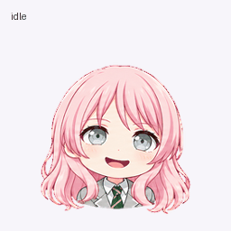
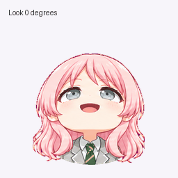

# 爱音 Dot 动画演示与素材

以千早爱音为灵感、使用 AI 辅助制作的非官方二创动画素材。这里收录适合 dot 展示的大头短肩版，以及全身 Work pet 版精灵图，供免费欣赏与个人非营利二创交流。本项目无商业收益，与原作权利方不存在隶属、合作或官方授权关系。

## 先看素材

| 动作预览 | 视线预览 |
| --- | --- |
|  |  |

- [Dot 版高清主图](assets/dot/key-art.png)：1205 × 1305，蓝色背景。
- [Dot 版完整精灵图](assets/dot/spritesheet.png)：大头短肩构图。
- [全身版完整精灵图](assets/full-body/spritesheet.png)：全身构图。
- [文件索引](FILES.md)与[素材来源及权利说明](ASSET-NOTICE.md)。

## 素材规格

| 项目 | 规格 |
| --- | --- |
| 精灵图版本 | v2 布局 |
| 完整精灵图 | 1536 × 2288 像素 |
| 单帧画布 | 192 × 208 像素 |
| 网格 | 8 列 × 11 行 |
| 动作状态 | 9 个 |
| 视线方向 | 16 个 |
| Dot 版 GIF 预览 | 256 × 256 像素 |

高清主图用于查看与展示。它不会改变精灵图的单帧规格，也不会突破运行时的分辨率限制。GIF 是便于浏览的预览文件，其尺寸不代表运行时单帧尺寸。

### 精灵图帧布局

下表行号从 1 开始；每行从左往右读取，超出有效帧数的格子不参与播放。

| 行 | 状态 | 有效帧数 |
| --- | --- | --- |
| 1 | 待机（idle） | 6 |
| 2 | 向右跑（running-right） | 8 |
| 3 | 向左跑（running-left） | 8 |
| 4 | 挥手（waving） | 4 |
| 5 | 跳跃（jumping） | 5 |
| 6 | 失败（failed） | 8 |
| 7 | 等待（waiting） | 6 |
| 8 | 运行（running） | 6 |
| 9 | 检查（review） | 6 |
| 10–11 | 16 个视线方向 | 每行 8 帧 |

视线从正上方开始，按顺时针每 22.5° 一个方向，先读取第 10 行，再读取第 11 行。

## 查看与使用

1. 点击上方链接查看或单独下载文件。
2. 制作帧动画时，保留原始精灵图与透明背景，按 192 × 208 的固定网格读取帧；按下表选择有效帧，不应将空白格作为动作帧播放。
3. 需要展示大图时使用 `key-art.png`；需要播放动作时使用完整精灵图中的实际帧序列。
4. 在其他环境中使用前，先确认其精灵图格式、帧顺序与显示规格。这里提供素材，不包含账户绑定的安装凭据或通用安装流程。

可下载[独立素材包](downloads/anon-dot-assets.zip)，包含上述五份角色素材、素材权利说明和 SHA-256 校验清单。

## 来源与权利

本仓库的角色图像与预览由本项目使用 AI 辅助生成。公开内容不包含官方原图、参考表情包、音声或模型文件。原角色及相关名称等第三方权利归各自权利人所有；公开分享不代表我们拥有原角色版权，也不授予完整商业使用权。

请参阅 [BanG Dream! 官方二次创作指南](https://bang-dream.com/bdp-guideline/)及本仓库的[素材说明](ASSET-NOTICE.md)。如另行发布独立自编代码，代码许可与角色图像、动画的权利说明分别适用，图像和动画不纳入 MIT 许可。
